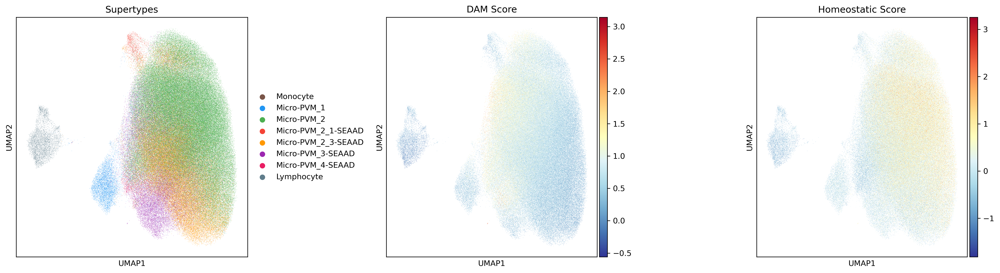
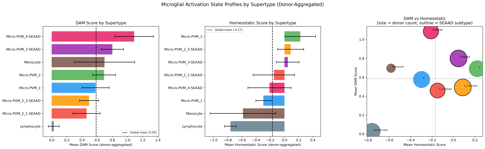
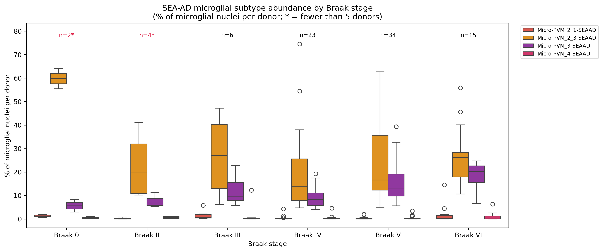
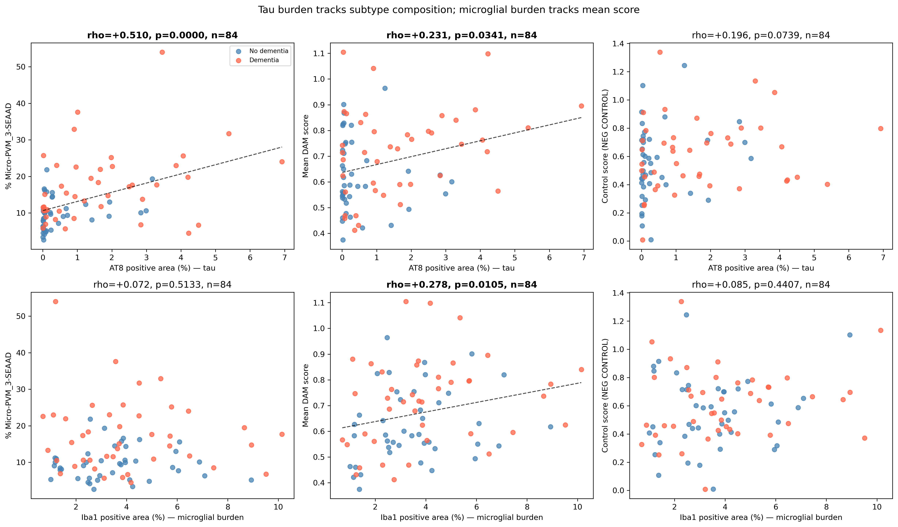
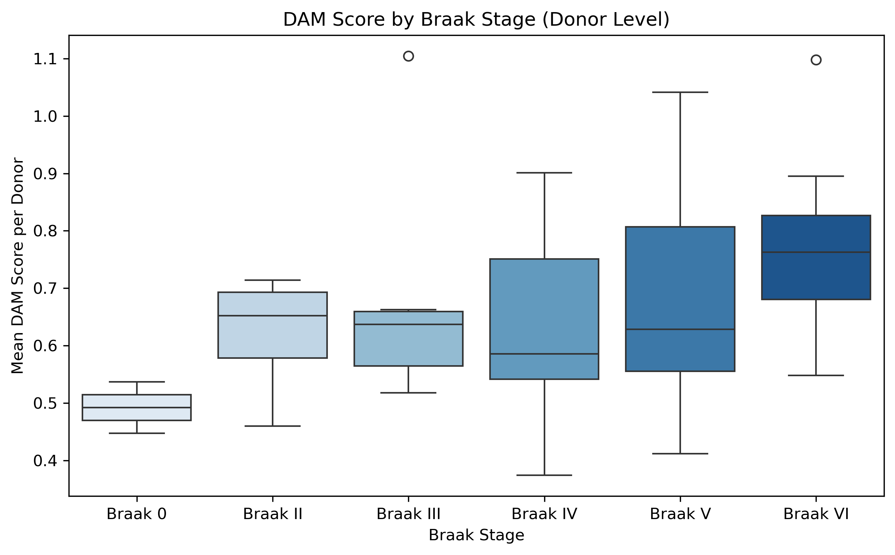
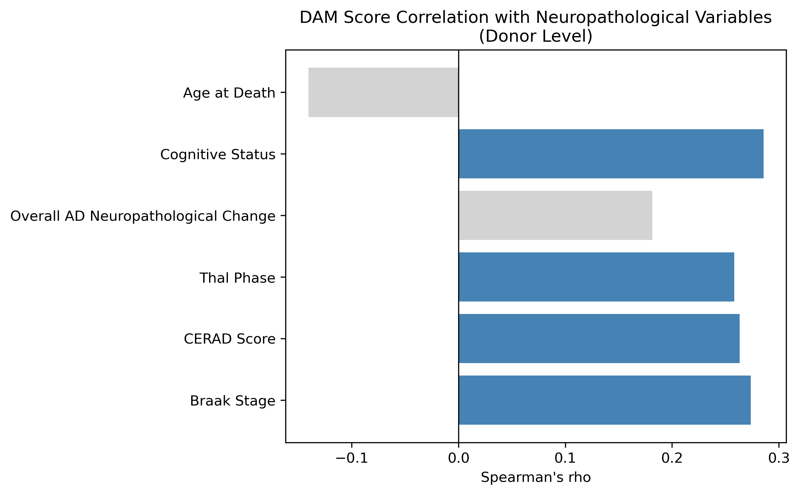
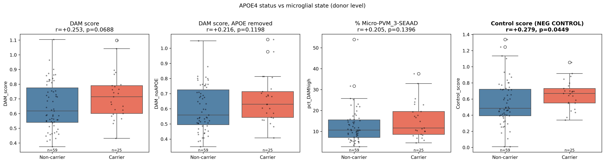
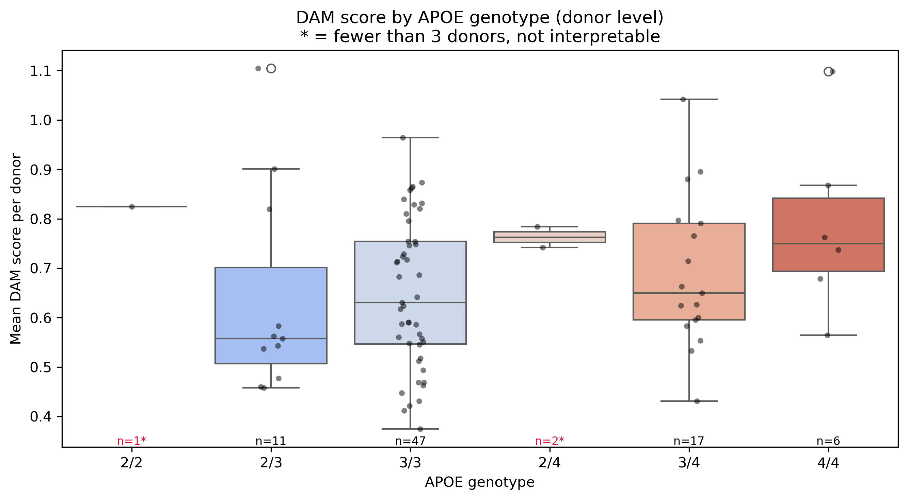
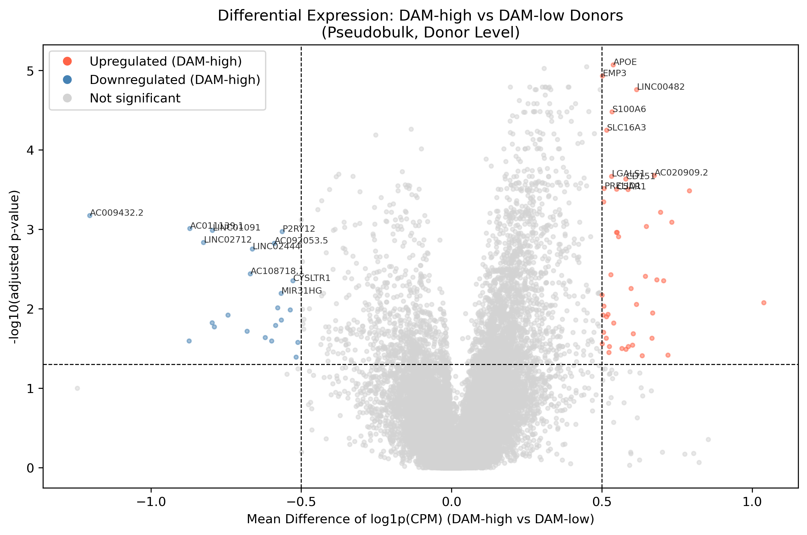

# SEA-AD Microglia snRNA-seq Analysis

## Summary

Microglia are the brain's resident immune cells. In Alzheimer's disease (AD) they shift out of their normal surveillance state into an activated one. Keren-Shaul et al. (2017) described this in mice and called the activated cells **disease-associated microglia (DAM)**, defined by a two-step gene program (a TREM2-independent first stage and a TREM2-dependent second stage). That signature was built from **mouse** cells. This project asks how well it carries over to **human** brain tissue.

The data come from the Seattle Alzheimer's Disease Brain Cell Atlas (SEA-AD): single-nucleus RNA-seq from 84 donors spanning the full range of AD pathology, from none to severe. I scored each microglial nucleus against the mouse DAM and homeostatic gene lists, summarized the results per donor, and tested them against each donor's neuropathology and cognitive records.

**Key findings**

1. **Composition beats averaging.** The share of a single DAM-like subtype (`Micro-PVM_3-SEAAD`) tracks tau burden far more strongly than the average DAM score across all microglia (Spearman ρ = 0.51 vs. 0.23). The disease signal sits in *which cells are present*, not in a uniform shift of every cell.
2. **Two separate processes.** Ordinary microglia raise DAM genes slightly in donors with more microglia overall, while the link to tau comes entirely from the DAM-like subtype becoming more common.
3. **The mouse signature transfers only partially.** Several of its strongest genes are barely detected in human nuclei. An unbiased dementia vs. no-dementia comparison instead recovers known human activation markers (`GPNMB`, `LGALS3`, `CHI3L1`) that are absent from the mouse list.

**Relation to prior work.** The expansion of `Micro-PVM_3-SEAAD` in AD was first reported by the SEA-AD consortium (Gabitto et al., 2024), using a continuous pseudoprogression score and differential abundance testing. This project replicates that finding by an independent route (mouse-signature scoring plus donor-level composition against standard pathology measures) and adds a direct comparison of composition against mean signature scoring.

---

## Results

After removing non-microglial nuclei and restricting to the middle temporal gyrus (MTG), the analysis covers 35,907 nuclei from 84 donors. All statistics are computed per donor, so n = 84 unless noted.

### 1. Count cells instead of averaging

The percentage of a donor's microglia that belong to the DAM-like subtype predicts their pathology much better than the average DAM score of all their microglia.

| Measure | % DAM-like subtype | Average DAM score |
| :---- | :---- | :---- |
| CERAD (plaques) | **0.52** | 0.26 |
| AT8 staining (tau) | **0.51** | 0.23 |
| Cognitive status | **0.48** | 0.29 |
| Braak stage (tau) | **0.45** | 0.27 |
| Thal phase (amyloid) | **0.45** | 0.26 |
| 6e10 staining (amyloid) | **0.34** | 0.21 |
| Iba1 (microglial amount) | 0.07 | **0.28** |

*(Spearman ρ, all 84 donors.)*

The gap follows from the subtype's size. `Micro-PVM_3-SEAAD` makes up only about 14% of microglia, so even a large expansion of it moves the all-cell average only slightly. Expressing composition as a log-ratio of `Micro-PVM_3-SEAAD` to the main `Micro-PVM_2` population, which avoids the constraint that percentages sum to 100%, gives the same picture (ρ = 0.46 with AT8).

**The subtype expands with disease:**

- With tau staining (AT8): ρ = 0.51, adjusted p < 0.0001
- With Braak stage, restricted to Braak III–VI (78 donors; stages 0 and II have too few donors): ρ = 0.40, adjusted p = 0.002
- With dementia: 9.3% → 15.3% of microglia (median), adjusted p = 0.0001

The Braak value here (0.40) is lower than in the table above (0.45) because it excludes the six donors at Braak 0 and II.

### 2. Two separate processes

Recalculating the DAM score using only ordinary `Micro-PVM_2` microglia:

|  | Iba1 (microglial amount) | AT8 (tau) |
| :---- | :---- | :---- |
| All microglia | 0.28 | 0.23 |
| `Micro-PVM_2` only | **0.28** | **0.12 (n.s.)** |

The Iba1 link survives inside ordinary microglia, but the tau link disappears. Ordinary microglia shift their DAM genes slightly in donors with more microglia overall, whereas tau pathology is tied specifically to the DAM-like subtype becoming more common.

### 3. The mouse signature transfers only partially

| Gene | Effect size in mouse | Detected in human nuclei |
| :---- | :---- | :---- |
| `CST7` | +6.08 (strongest in the source) | **1.0%** |
| `CSF1` | +5.23 | **0.5%** |
| `LPL` | +4.95 | 5.5% |
| `SERPINE2` | +2.00 | 2.9% |

Low detection is not limited to DAM genes. The homeostatic markers `TMEM119` and `SALL1` are detected in only 21% and 20% of nuclei, and even the stable control gene `HEXB` in only 24%.

The mouse framework also does not map cleanly in two other ways:

- The two DAM stages only loosely track each other (ρ = 0.33).
- At the single-nucleus level, DAM and homeostatic scores do not oppose each other as they do in mouse (ρ = +0.05).

### 4. Human activation genes without a preset list

Comparing donors with and without dementia (42 vs. 42) across all 17,351 well-detected genes, with no preset list, gave **319 significant genes** (FDR < 0.05). The genes higher in dementia are recognized human microglial activation markers:

`GPNMB` · `LGALS3` (galectin-3) · `CHI3L1` (YKL-40, a clinical AD biomarker) · `CD44` · `PLIN2` · `S100A4` · `LYZ` · `FLT1`

None of these are in the mouse DAM list, which suggests they are a better starting point for studying activation in human tissue.

Individual signature genes moved in the expected directions: `CTSD` (adj. p = 0.015), `CD9` (0.040) and `LPL` (0.045) were higher in dementia; `CX3CR1`, `P2RY12` and `P2RY13` were higher in donors without dementia, though not significantly.

### 5. Negative controls

A set of microglial genes that barely change in the mouse source data was scored alongside the signatures.

**Sequencing depth is not driving the donor-level results.** Per donor, DAM score versus depth is ρ = −0.004.

**Tau and cognition are subtype-specific; amyloid is less so.** The table below gives the *specificity gap*: the subtype-composition correlation from Result 1 minus the same correlation for the control score. It uses the complement-free control (`CSF1R`, `CTSS`, `CST3`, `HEXB`), because the complement genes `C1QA/B/C` in the original 7-gene control turned out to rise with AD in human tissue (see Limitations).

| Measure | Specificity gap |
| :---- | :---- |
| Cognitive status | **0.41** |
| Braak (tau) | **0.34** |
| AT8 (tau) | **0.32** |
| CERAD | 0.27 |
| Thal (amyloid) | 0.15 |
| 6e10 (amyloid) | 0.14 |

Amyloid measures move the control genes nearly as much as the DAM genes, which suggests amyloid raises microglial gene expression broadly while tau and cognitive decline track the DAM-like subtype specifically. With only four genes, this control is noisy, so these gaps should be read as relative rather than exact.

### 6. Null results

- **APOE4 carriers (25 vs. 59).** No measure survived correction. With the original 7-gene control, the control score was the *most* significant panel (p = 0.045); with the complement-free control it dropped to p = 0.132. Removing `APOE` from the DAM score barely changed it (ρ = 0.98), so the result is not circular.
- **Signature enrichment in the differential expression.** DAM genes ranked toward the dementia side (27.6th percentile), but the complement-free control ranked the same way (25.0th; the 7-gene control, 19.5th). Inconclusive.
- **Age at death and overall AD neuropathological change.** Neither correlated with the DAM score.

---

## Figures

### 1. Microglial subtypes and activation scores



SEA-AD's microglial subtypes shown beside the DAM and homeostatic scores. The
subtypes occupy different parts of the map, and the two scores form opposing
gradients across it.

### 2. Activation profile of each subtype



Average DAM and homeostatic score for every subtype, calculated per donor first.
`Micro-PVM_3-SEAAD` is the most DAM-like of the well-represented subtypes.
**`Micro-PVM_4-SEAAD` appears highest but has only 2 donors and is not
interpretable.**

### 3. Subtype abundance across Braak stages



How the proportions of the three main subtypes shift as tau pathology worsens.
`Micro-PVM_3-SEAAD` (purple) grows while `Micro-PVM_2` (green) shrinks. Braak 0
and II have too few donors to trust and are marked in red.

### 4. Composition and score against tissue staining



Two ways of measuring the same thing, compared against protein staining from the
same tissue. Counting cells of the DAM-like subtype tracks tau strongly
(rho = 0.51); averaging DAM scores tracks overall microglial abundance instead
(rho = 0.28). The right-hand column is the negative control.

### 5. DAM score across Braak stages



Average DAM score per donor, grouped by tau stage. The upward trend is real but
modest, and the spread within each stage is wide.

### 6. DAM score against pathology measures



Correlation between each donor's average DAM score and their pathology and
cognitive measures. Four of six are significant.

### 7. APOE4 carriers versus non-carriers



Four measures compared between APOE4 carriers and non-carriers. Only the negative
control panel reaches significance, which is why this result is reported as null.

### 8. DAM score by APOE genotype



The same data split by exact genotype. Scores drift upward with more copies of
E4, but two genotype groups have fewer than 3 donors and cannot be interpreted.

### 9. Genes differing between dementia and no-dementia donors



Every gene tested, plotted by size of difference (left–right) against confidence
(up–down). Genes higher in dementia sit on the left. Circled points are the
pre-selected signature genes, marked so they are not mistaken for discoveries.

---

## Methods

### Gene signatures

Built from the differential expression results in Keren-Shaul et al. (2017), Supplementary Table S3 ("Differential Expression Analysis of Homeostatic Microglia to DAM"), with stage assignments from their Figure 2.

A gene was kept if it had a clear one-to-one mouse–human ortholog and was significant in the source (FDR < 0.05). Detection in human nuclei is reported in Result 3 rather than used to silently drop genes, except where a gene was essentially absent.

**DAM signature (27 genes)**

*Stage 1 (TREM2-independent):* `APOE` `TYROBP` `B2M` `FTH1` `CTSB` `CTSD` `CSTB` `TIMP2`

*Stage 2 (TREM2-dependent):* `CST7` `CLEC7A` `LPL` `ANKH` `SPP1` `AXL` `CSF1` `ITGAX` `CADM1` `CD63` `CD9` `SERPINE2` `GUSB` `CTSZ` `HIF1A` `CTSL` `CD68` `CTSA` `TREM2`

**Homeostatic signature (26 genes)**

`TMEM119` `P2RY12` `P2RY13` `TXNIP` `CX3CR1` `SERINC3` `TGFBR1` `GLUL` `MAF` `CD164` `ZFHX3` `SRGAP2` `RHOB` `CMTM6` `ADGRG1` `LPCAT2` `MARCKS` `SLCO2B1` `SELPLG` `SALL1` `BIN1` `ITGAM` `PMEPA1` `OLFML3` `EPB41L2` `PTGS1`

**Negative control (7 genes):** microglial genes that barely change between the two states in the mouse source. If these move with disease, a signal may be technical or general rather than DAM-specific. A complement-free 4-gene version (`HEXB` `CTSS` `CSF1R` `CST3`) is used where noted.

`HEXB` `C1QA` `C1QB` `C1QC` `CTSS` `CSF1R` `CST3`

**Excluded:** `H2-D1`, `Lyz2`, `Ccl6` (no clean human ortholog) and `CD52` (detected in only 0.3% of nuclei).

### Pipeline

The full analysis lives in `notebooks/SeaAD_Analysis.ipynb`. Cells run in order.

| Cell | Name | What it does |
|---|---|---|
| **1** | Imports | Loads Scanpy, pandas, NumPy, SciPy, seaborn and matplotlib |
| **2** | Load data | Reads the microglia `.h5ad` object, donor metadata and neuropathology tables |
| **3** | Donor-level labels | Summarizes the cohort per donor rather than per nucleus |
| **4** | Existing annotations | Prints SEA-AD class, subclass and supertype labels |
| **4B** | Remove non-microglia | Drops monocyte and lymphocyte nuclei; their abundance tracked Braak stage (Spearman ρ = 0.24), so leaving them in would confound results |
| **5** | Check normalization | Confirms the expression matrix is log1p-normalized |
| **6** | Existing UMAP | Plots the Allen Institute UMAP by subtype, cognitive status, Braak stage and donor |
| **6B** | Region coverage | Measures each donor's regional mix and checks it is not confounded with pathology (it is not) |
| **6C** | Restrict to MTG | Keeps only middle temporal gyrus nuclei |
| **7** | Neuropathology join | Merges 12 quantitative staining measurements by donor |
| **8** | Gene set scoring | Scores every nucleus against the DAM, homeostatic and control lists (`score_genes`), plus DAM stage subscores; sanity-checks how the scores relate to each other and to depth |
| **8B** | Subtypes vs. score zones | Plots subtype labels beside DAM and homeostatic scores on the UMAP |
| **8C** | Scores per subtype | Averages scores per donor per subtype and compares each subtype to that donor's others (paired Wilcoxon signed-rank, Benjamini–Hochberg corrected) |
| **8C diag.** | Control score check | Runs the same paired test on the control score, which should stay flat |
| **9** | Composition vs. Braak | Tests each donor's subtype percentages against tau stage (Spearman, Kruskal–Wallis) and dementia status (Mann–Whitney U), BH-corrected |
| **10** | DAM score vs. pathology | Spearman correlations between mean DAM score and 6 pathology and cognitive measures plus quantitative staining, BH-corrected |
| **10 diag.** | Control and depth check | Tests whether the control score and sequencing depth also track pathology |
| **10B** | Composition vs. staining | Tests subtype percentage against protein staining (Spearman, BH-corrected) |
| **11** | APOE4 | Carriers vs. non-carriers (Mann–Whitney U, rank-biserial effect size) and E4 copy number (Spearman); rescores without `APOE` to rule out circularity |
| **11B** | Complement-free control | Repeats specificity comparisons after dropping complement genes from the control set |
| **12** | Pseudobulk DE | Sums raw counts per donor, CPM-normalizes, drops mitochondrial and low-expression genes, tests all genes (Mann–Whitney U, BH), and checks signature enrichment (Wilcoxon rank-sum) |

---

## Limitations

**Nuclei, not whole cells.** Single-nucleus data miss most cytoplasmic RNA. The mouse signature was defined in whole cells, which may explain part of the poor transfer.

**Microglia and perivascular macrophages (PVM) are not separated.** SEA-AD labels them together as "Microglia-PVM," with no PVM-specific subtype. Perivascular macrophages express several DAM genes, so some signal may come from them.

**One brain region.** MTG was chosen because it is the only region sampled in all 84 donors and the region where the quantitative neuropathology was measured. Results may differ elsewhere in the brain.

**Imperfect negative control.** The original 7-gene control includes complement genes (`C1QA/B/C`), which rise in human AD. Removing them leaves only four genes, which is too few for a stable estimate. A stronger approach would compare against many random gene sets matched for expression level.

**Uneven stage sizes.** Braak 0 has 2 donors and Braak II has 4, so those stages are excluded from trend tests.

**Linked proportions.** Subtype percentages must sum to 100%, so one rising forces others down. The log-ratio in Result 1 avoids this constraint, but a subtype shrinking in relative terms does not mean it is being suppressed.

**Residual contamination.** `BANK1` and `PRKCQ` (B- and T-cell genes) appear among genes higher in no-dementia donors, and 16% of the significant novel genes are unnamed lncRNAs. Both point to leftover ambient RNA.

---

## Setup

### 1. Clone the repository

```bash
git clone https://github.com/wnguyen36/SEAAD-microglia-analysis.git
cd SEAAD-microglia-analysis
```

### 2. Create the environment

Built and tested on Python 3.10.2.

```bash
conda create -n seaad python=3.10.2
conda activate seaad
pip install -r requirements.txt
```

### 3. Download the data

Download the files below from the [SEA-AD portal](https://brain-map.org/consortia/sea-ad/our-data) and place them in `data/`.

| File | Save as | Notes |
| :---- | :---- | :---- |
| Microglia-PVM snRNA-seq object | `data/SEAAD_microglia.h5ad` | ~2 GB. Under "Single nucleus omics" |
| Donor clinical metadata | `data/SEAAD_donor_metadata.xlsx` | Age, sex, Braak, CERAD, APOE, cognitive status |
| Quantitative neuropathology | `data/SEAAD_neuropathology.csv` | Iba1, AT8, 6e10, NeuN image measurements |

**Version note:** SEA-AD updated several files in June 2026. This analysis used the versions available before that update. Neuropathology measurements are from the MTG only.

### 4. Run the notebook

```bash
jupyter notebook notebooks/SeaAD_Analysis.ipynb
```

Run cells in order from the top. Figures save to `figures/` and tables to `results/`.

### Repository layout

```
SEAAD-microglia-analysis/
├── data/                       # downloaded SEA-AD files (not tracked)
├── figures/                    # figures shown in this README
├── notebooks/
│   └── SeaAD_Analysis.ipynb    # the full analysis
├── results/                    # generated tables and outputs (not tracked)
├── LICENSE
└── README.md
```

---

## Citations

**Data**

Seattle Alzheimer's Disease Brain Cell Atlas (SEA-AD), Allen Institute for Brain Science. https://portal.brain-map.org/explore/seattle-alzheimers-disease

**Prior SEA-AD analysis**

Gabitto, M. I., Travaglini, K. J., et al. (2024). Integrated multimodal cell atlas of Alzheimer's disease. *Nature Neuroscience*, 27(12), 2366–2383. doi:10.1038/s41593-024-01774-5

**Gene signatures**

Keren-Shaul, H., Spinrad, A., Weiner, A., et al. (2017). A unique microglia type associated with restricting development of Alzheimer's disease. *Cell*, 169(7), 1276–1290. doi:10.1016/j.cell.2017.05.018
